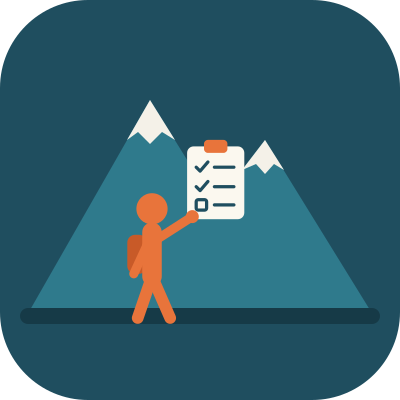

# TaskSherp

CSCI 343 FINAL Programming Languages Project

By Anthony Millspaugh

## Overview

### Inspiration:
As someone who tends to struggle with keeping on top of tasks and following a to-do list, I have been wanting to create a personal task management app for quite a while now. This final project gave me an opportunity to not only learn Kotlin, but it also gave me an opportunity to fulfill that desire of creating a personal task management app. By using Kotlin Multiplatform, I can make it easily usable across all of my devices as well. While the original goal for this app is to complete my final project and give myself a nice app to use for myself, I will also be using it at my first fully fledged software development project.

### Technology Stack:
This project is built using solely Kotlin, sharing UI, logic, and networking across Android (Kotlin/JVM), Desktop (Kotlin/JVM), and Web (Kotlin/Wasm) from a single codebase in commonMain.

### Functionality:
The user will be able to do multiple things such as:
* Track tasks in a calendar 
* Organize tasks into recurring time slots
* Make custom tags for different types of tasks (Homework, Hobby, Event, etc.) 
* Allow the app to notify them when a task is coming up
* Create custom task templates, such as breaking up tasks with 15-minute breaks automatically when creating a new task
* And more to come as I come up with ideas

## How to use this software

### Bad news...
You can't yet! I haven't finished :) When I have my first working version, then I will update these instructions.